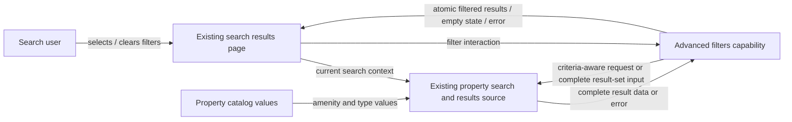
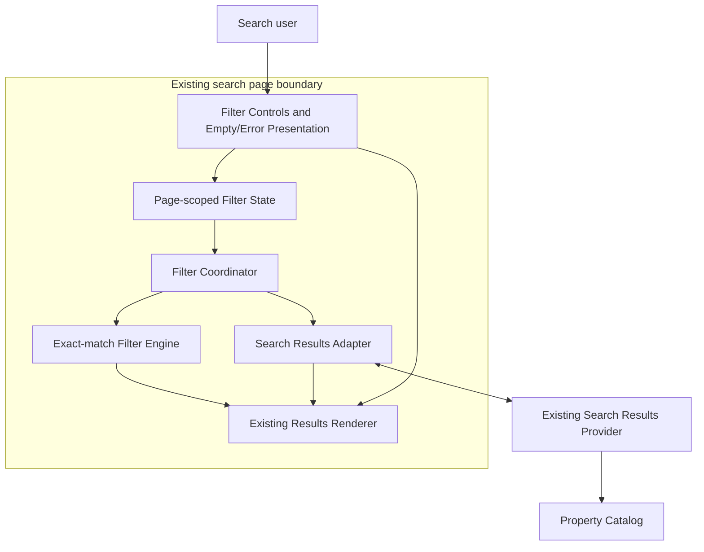

# Architecture — US-001

## 1. Architecture Overview
Add a stack-independent advanced-filter capability within the existing property search results experience. Keep the search context and its unfiltered result set authoritative; maintain amenity/type selections only for the lifetime of the currently displayed page; derive and publish a complete filtered result set on every selection change. No new service, database, infrastructure, or application technology is prescribed: repository framework folders contain no selected application stack, and the source-code instructions explicitly say the stack is unselected.

Driving requirements are REQ-003/005/006/014/015/016 and BR-001/002 (exact matching and AND/OR/intersection semantics), REQ-009/010/013 and BR-003 (clear and search-context behavior), NFR-001 (complete/correct results), NFR-002/005 (page-only state and privacy), NFR-003 (≤1 s p95 for 1,000 results), NFR-004 (WCAG 2.1 AA and keyboard), and NFR-006 (atomic error handling). The scope is the existing results page; metadata management and changes to search behavior remain out of scope.

The proposed logical design has a filter controls/presentation component, page-scoped filter state, a deterministic filtering coordinator/engine, and an adapter to the existing search results/data source. The adapter is a boundary, not a commitment to a specific API or execution location. Before implementation, confirm whether the existing search page exposes the complete applicable result set or supports criteria-aware search; otherwise the completeness promise in NFR-001 cannot be assured.

## 2. Architecture Principles
| Principle | Rationale | Requirements |
|-----------|-----------|--------------|
| Preserve the existing search context and treat it as immutable input to advanced filtering. | Advanced filters must not alter destination, dates, or other search inputs. | REQ-009, REQ-010, REQ-013, BR-003 |
| Use explicit, deterministic catalog-value matching and documented boolean semantics. | Prevent false positives and make result behavior predictable. | REQ-003, REQ-005, REQ-006, REQ-014, REQ-015, REQ-016, BR-001, BR-002 |
| Publish result sets atomically. | No stale partial/intermediately filtered data should be presented when an operation fails. | NFR-001, NFR-006 |
| Keep filter state page-scoped and ephemeral. | Meet retention/privacy constraints without adding storage or tracking. | REQ-011, NFR-002, NFR-005 |
| Integrate through existing boundaries; do not introduce a new platform or service without approval. | The codebase has framework folders only and no application stack selection. | REQ-001–016, NFR-001–006 |
| Make controls perceivable, operable, and understandable without a pointer. | Accessibility is an explicit requirement, not a later enhancement. | NFR-004 |

## 3. High-Level Architecture Diagram


## 4. Component Diagram


## 5. Component Responsibilities
| Component | Responsibility | Depends on | Supports (REQ/NFR) |
|-----------|----------------|------------|--------------------|
| Filter Controls and Empty/Error Presentation | Render the amenities and property type options from the existing catalog; expose immediate multi-select and clear-all actions; present no-match and operation-error states. Keep options visible even when no current result matches. | Page-scoped Filter State; existing page design system, if present | REQ-001, REQ-002, REQ-004, REQ-007, REQ-008, REQ-012, NFR-004, NFR-006 |
| Page-scoped Filter State | Hold selected amenity/type IDs only in the active page instance; retain selections through same-page search-context changes; clear on page teardown/reload; do not serialize to URL, browser storage, or server. | Filter Controls; Filter Coordinator | REQ-011, REQ-013, NFR-002, NFR-005 |
| Filter Coordinator | Orchestrate each selection update, pass unchanged search context plus criteria to the chosen execution path, associate results with the latest criteria, and commit complete results atomically. On failure retain selections and show prior valid results only if they belong to the same search context; otherwise show no results for the failed new context. Never present partial or stale-context output. | State; Filter Engine; Search Results Adapter; Results Renderer | REQ-003–010, REQ-012–014, NFR-001, NFR-006, BR-001–003 |
| Exact-match Filter Engine | Apply exact catalog-value matching: all selected amenities (AND), any selected property type (OR), and intersection between categories (AND). Exclude missing/unrecognized relevant values when that category is filtered. | Complete result input and selected criteria | REQ-003, REQ-005, REQ-006, REQ-014–016, NFR-001, NFR-003, BR-001, BR-002 |
| Search Results Adapter | Translate the stack-independent request/response contract to the existing search provider. Must provide complete matching results for the current search context (locally filter a complete set or delegate exact criteria filtering); normalize provider errors and reject incomplete/partial responses. | Existing Search Results Provider | REQ-009, REQ-010, REQ-013, NFR-001, NFR-006, BR-003 |
| Existing Results Renderer | Render the committed filtered/unfiltered results and preserve the existing search inputs and page behavior. | Coordinator; existing search page | REQ-001, REQ-005–010, REQ-013, NFR-001, NFR-004 |

## 6. Data Flow Diagram
```mermaid
sequenceDiagram
  actor U as User
  participant C as Filter Controls
  participant S as Page Filter State
  participant O as Coordinator
  participant A as Search Results Adapter
  participant P as Existing Search Provider
  participant E as Exact-match Engine
  participant R as Results Renderer
  U->>C: Select/deselect amenity or type
  C->>S: Update page-only criteria
  S->>O: Criteria + unchanged search context
  O->>A: Request complete result set for context and criteria
  A->>P: Criteria-aware request OR retrieve complete context set
  alt Provider response is complete and successful
    P-->>A: Complete result records
    A-->>O: Complete records + request identity
    opt Local exact-match path is selected
      O->>E: Complete records + criteria
      E-->>O: Fully evaluated result set
    end
    O->>R: Atomically commit latest complete result set
    R-->>U: Results or explicit no-match state with clear action
  else Provider failure, timeout, malformed or partial response
    P-->>A: Failure or invalid/incomplete response
    A-->>O: Normalized error; no result payload
    O->>R: Error state; preserve criteria; keep prior results only for same context
    R-->>U: Error message; no partial filtered result set
  end
```

## 7. API and Integration Design
These are logical contracts. Concrete names, transport, serialization, timeout, and pagination conventions are deferred to the existing stack/provider. Criteria are identifiers from the existing catalog, not free-form query fragments.

| Interface | Operation | Input | Output | Errors | Auth |
|-----------|-----------|-------|--------|--------|------|
| Filter Controls → Page Filter State | `setCriteria` / `clearAll` | Sets of selected amenity IDs and property-type IDs; clear has no payload | Updated immutable criteria snapshot; clear produces empty sets | Reject unknown/non-catalog IDs as invalid input; do not mutate state on invalid input. Normal user deselection is not an error. | Existing page authentication/authorization applies; no new identity or permission is introduced. |
| Coordinator → Search Results Adapter | `getFilteredResults` | Existing search-context reference (read-only), amenity ID set, property-type ID set, monotonically increasing request identity | Complete result collection for the exact context and criteria, plus request identity and completeness indication | Provider/network/timeout error; invalid criteria; malformed response; explicit incomplete/partial response. Adapter returns typed failure and no partial collection. | Delegate to existing provider's authenticated session/authorization; never elevate access. |
| Coordinator → Exact-match Engine | `filterCompleteSet` | Complete unfiltered set for current search context; selected catalog IDs | Complete filtered set; empty collection is a successful no-match result | Invalid record shape/criteria fails evaluation; missing/unrecognized relevant attributes are excluded per REQ-016, not treated as matches. Never return a partially evaluated set. | In-process operation within existing page boundary. |
| Coordinator → Results Renderer | `commit` / `showError` | Successful full result set and criteria identity, or normalized error with retained criteria | Rendered result state, explicit no-match state, or error state | Stale request identity is discarded; rendering failure is reported through existing page error handling. No partial data commit. | Existing page boundary. |

The adapter contract has two viable execution modes: (1) local exact filtering only when the provider supplies the complete current-search result set, or (2) criteria-aware provider search that guarantees all matches in that search context. Neither paginated subsets nor silent truncation satisfy completeness. A changed search context is passed unchanged with current criteria (REQ-013). Clear-all sends empty criteria and restores/re-requests the complete current-context set (REQ-009). If a newer request supersedes an older one, only the newest matching request identity may commit.

External integration failure behavior: a provider failure, timeout, malformed response, or explicit partial result causes a normalized error; retain the user's chosen criteria; show a recoverable error; do not show partially filtered results. A previously valid result set may remain visible only while its search context is unchanged; on a failed search-context change, do not show results from the prior context. A successful empty collection is not an error and renders the explicit no-matching-results state with clear-filters action. Existing authentication failures use the page's established sign-in/authorization handling and must not be recast as an empty result.

## 8. Data Model
- **FilterCriteria (ephemeral value):** set of amenity catalog IDs and set of property-type catalog IDs. Empty sets mean no advanced filter in that category. Values are exact catalog identifiers; displayed labels (including "Free Wi-Fi", "Breakfast included", "Hotel", "Villa") come from the existing catalog. No synonym/fuzzy normalization.
- **SearchContext (owned by existing search):** existing destination, dates, and other search inputs. Referenced read-only; advanced filters neither mutate nor copy these inputs into new persistence.
- **PropertyResult (owned by existing provider):** existing property identifier, catalog property-type ID (may be absent/unrecognized), and amenity ID collection (may be absent). Do not duplicate or own property metadata in this feature.
- **FilterResult (transient):** complete collection of matching property results and request identity; empty is valid. Incomplete collections are invalid and cannot be committed.
- **Relationships and semantics:** each property has zero or more amenity values and one property type per the approved story assumptions. For selected amenities, property membership must include every selected ID. For selected types, its type must equal any selected ID. When both categories are nonempty, both category predicates must be true. If a category is unfiltered, missing values in that category do not exclude the property; if filtered, missing/unrecognized data excludes it.
- **Ownership/storage/retention:** catalog and property data remain with existing provider; context remains with existing search page. Criteria are held only in the active page's volatile state and cleared at page teardown/reload. No new database, server session, URL parameters, local/session storage, cookie, analytics event, or personal data item.
- **Privacy classification:** criteria are preference data, but not linked to a new identity or persisted. Existing provider logs and telemetry must not be expanded to capture criteria or property-level personal data for this feature.

## 9. Security Architecture
- **Trust boundaries:** user-controlled control events enter the existing page; criteria cross the adapter boundary into the existing search provider; provider results return to the page. Treat provider data and catalog values as untrusted input until shape/type validation succeeds.
- **Authentication/authorization:** inherit the existing search page and provider session and authorization checks. This feature adds no login, role, permission, or privileged endpoint. The provider must apply the user's existing access scope to every request.
- **Input validation:** accept only catalog identifiers supplied by the existing option source; constrain values to expected scalar identifiers/sets, reject malformed or unknown IDs, and pass parameters through the provider's established safe query mechanism. Do not construct executable query strings from labels.
- **Output safety:** render labels and provider fields using the existing safe text/rendering mechanisms; do not interpret catalog labels or error details as markup. Map provider failures to user-safe messages.
- **Data protection and retention:** no new persistent data, credentials, or personal data. Use existing protected transport for any provider communication and existing data-at-rest protections; exact transport/storage controls depend on the unselected stack. Do not log selected criteria, full property records, credentials, or raw provider errors.
- **Abuse and error handling:** preserve existing request authorization, input size limits, timeout/rate controls, and error monitoring. Never bypass provider access rules in a local path; local filtering may operate only on results the user is already authorized to see.
- **Audit/observability:** no new audit trail or analytics of filter choices; record only non-sensitive operational failures using existing policy, subject to privacy review. Review browser telemetry and provider logging to ensure criteria are not incidentally persisted.

## 10. Deployment Architecture
Deploy as an addition to the existing search page/application boundary; no separate service or deployment unit is justified. The host, runtime, environments, build/release process, network topology, scaling, and availability model are deliberately unspecified because the repository has no selected application stack or confirmed production topology. Preserve the existing deployment and release controls once identified.

Concrete operational strategies, subject to confirming host capability:
- For a complete result set of at most 1,000 records, use an in-memory exact-match evaluation with precomputed amenity membership sets during a filter operation; replace the displayed result collection atomically. Measure interaction-to-render latency and meet ≤1 s p95 at 1,000 records. If provider round-trip dominates, the criteria-aware provider path must meet the same end-to-end target; no cache is introduced because freshness and consistency requirements are not defined.
- Do not add a cache, background worker, database, or scaling tier. Concurrent interactions use request identities and discard superseded responses.
- Use existing application monitoring for provider failures and latency; report aggregate operational measures without collecting filter selections or personal data. Alerting thresholds and deployment-specific instrumentation remain an open decision.
- Availability follows the existing search page; there is no separate feature availability target. If the provider fails, show the error and retain criteria, with no partial result display.

## 11. Technology Stack
| Layer | Choice | Justification | ADR |
|-------|--------|---------------|-----|
| Application language/framework/runtime | **Proposed: use the existing search application's selected stack; no choice can be made from repository evidence.** | The source-code instructions mark stack as placeholder and repo contains framework folders only. Must fit existing page and approved platform scope without inventing a framework. | ADR-003 (proposed) |
| UI controls/accessibility | **Proposed: existing page component/design system and accessibility primitives, if available.** | Avoid a new UI dependency; must verify keyboard-only operation and WCAG 2.1 AA. | ADR-003 (proposed) |
| Search integration/transport | **Proposed: existing search provider contract, to be discovered and confirmed.** | No API, protocol, or provider implementation is evidenced. Completeness and failure behavior are mandatory independent of transport. | ADR-001 (proposed) |
| Result evaluation | Stack-neutral exact set operations; execution location proposed pending provider capability. | Implements required boolean semantics; local evaluation is permissible only with complete result input. | ADR-001 (proposed) |
| State and persistence | Volatile active-page state; no durable store or URL persistence. | Directly implements retention/privacy constraints. | ADR-002 |
| Hosting/deployment/observability | Existing deployment and observability only; details deferred. | No infrastructure is selected or evidenced. | ADR-003 (proposed) |

## 12. Architecture Decision Records
### ADR-001 — Complete-result filtering integration (proposed) (REQ-003, REQ-005, REQ-006, REQ-009, REQ-013, NFR-001, NFR-003, NFR-006)
- **Why required:** Filtering must be complete and correct over the current search context, respond within the target, and fail without showing partial results. The existing provider's capabilities and result pagination are unknown.
- **Alternatives:**
  1. **Client-side filtering of a complete current-context result set.** Advantages: deterministic local exact matching, simple atomic evaluation, avoids per-selection provider round-trips. Disadvantages: requires all relevant results available to the page; transfer/memory and stale-data concerns; unsuitable if provider paginates/truncates.
  2. **Criteria-aware filtering by the existing search provider.** Advantages: provider can search beyond the loaded page and own catalog semantics; avoids transferring all records. Disadvantages: depends on provider exact AND/OR semantics, completeness contract, and response latency; introduces request failures/races.
  3. **Hybrid: provider for complete context data plus local evaluation, or provider criteria search with local validation.** Advantages: can fit existing capabilities while preserving explicit contracts. Disadvantages: more integration complexity and potential semantic divergence.
- **Advantages / disadvantages:** Option 1 is simplest when completeness is assured; option 2 scales better to large/unbounded results but needs an explicit provider contract; option 3 is flexible but increases complexity.
- **Trade-offs:** Completeness and NFR-001 take precedence over filtering only currently loaded rows. No mode is acceptable if results are silently truncated or pagination omits matching properties. End-to-end p95 includes provider time where remote calls are needed.
- **Decision:** **Proposed**, pending Open Question OQ-1. Inspect the existing search page/provider, pagination, and API contract; select the simplest mode that guarantees complete matching results and ≤1 s p95 at 1,000 records.
- **Consequences:** Adapter must expose completion status, request identity, normalized errors, and never yield a partial commit. Verify parity with all REQ/BR matching semantics before approval.

### ADR-002 — Ephemeral filter state and non-shareable URL (REQ-011, REQ-013, NFR-002, NFR-005)
- **Why required:** Filter values must persist within the active results page, follow search-context changes, and not survive page lifetime or be collected as new analytics/personal data.
- **Alternatives:**
  1. **Volatile state owned by the active page.** Advantages: naturally discarded on reload/leave; no storage or URL leakage; minimal implementation. Disadvantages: user loses selections on refresh/navigation; integration must preserve it during same-page search changes.
  2. **URL query parameters.** Advantages: native navigation/back-forward and share/bookmark behavior. Disadvantages: conflicts with page-lifetime-only requirement and can expose preferences in browser history/referrers/logs.
  3. **Browser storage or server session.** Advantages: can survive reload/navigation. Disadvantages: explicitly violates no persistence beyond page lifetime, adds cleanup/privacy/security concerns.
- **Advantages / disadvantages:** Volatile page state best meets stated requirements and avoids additional data handling; alternative persistence offers continuity but conflicts with NFR-002/NFR-005.
- **Trade-offs:** Preserve state only while the same active page instance handles new search inputs; clear upon teardown/reload, with no restoration.
- **Decision:** Volatile page-owned state, no URL or durable storage.
- **Consequences:** The page integration must preserve state through in-page search-context updates and clear it on page lifetime end. Filter selections must not be captured in new logs or analytics.

### ADR-003 — Application stack and deployment binding (proposed) (REQ-001, REQ-012, NFR-003, NFR-004, NFR-006)
- **Why required:** UI, accessibility implementation, provider integration, performance verification, and deployment depend on the host application's language, framework, component library, and runtime. None is selected in repository instructions or evident from the framework-only structure.
- **Alternatives:**
  1. **Bind to the existing application stack after repository/product discovery.** Advantages: consistent with current application, no needless platform. Disadvantages: stack and host capabilities must be confirmed before interface and implementation details can be finalized.
  2. **Select a new framework/runtime for this feature.** Advantages: could target a desired platform or component model. Disadvantages: unsupported by requirements, adds dependencies and deployment complexity, risks creating a separate feature surface.
  3. **Implement a technology-neutral service or standalone widget.** Advantages: nominal separation. Disadvantages: no service need is established; integration/auth/accessibility and deployment remain harder.
- **Advantages / disadvantages:** Existing-stack binding minimizes scope and integration risk; new-stack or standalone choices offer no evidenced benefit and add operational ownership.
- **Trade-offs:** Keep this proposal technology-neutral until the human confirms the actual application repository, target platform, existing UI system, and provider integration. Do not interpret framework folders as a selected stack.
- **Decision:** **Proposed:** bind to the existing application stack and deployment if confirmed; do not introduce a new framework, service, or infrastructure. Resolve OQ-2 before phase 3/implementation planning.
- **Consequences:** Technology-specific API details, WCAG verification tooling, deployment topology, and p95 measurement environment remain open. No stack-dependent implementation decision is final.

## 13. Risks and Constraints
| ID | Risk / constraint | Likelihood | Impact | Mitigation | Related REQ/NFR |
|----|-------------------|------------|--------|------------|-----------------|
| R-01 | Existing search page/provider is stated as a dependency but not verified; it may not expose complete results or criteria-aware filtering. | Medium | High: cannot guarantee that no matching property is omitted. | Resolve OQ-1; inspect provider contract and pagination; require complete-result semantics and reject partial responses. | REQ-003, REQ-005, REQ-006, REQ-009, NFR-001, NFR-006 |
| R-02 | No application stack, target platform, or deployment is selected; UI/API/deployment choices cannot be concretized. | High | High: may need design revision after host discovery. | Resolve OQ-2; keep ADR-003 proposed and avoid stack/infrastructure assumptions. | REQ-001, REQ-012, NFR-003, NFR-004 |
| R-03 | Catalog option set and canonical identifiers are unknown; exact matching may be undermined by inconsistent provider data. | Medium | Medium/High: selections may not correspond to property metadata. | Confirm catalog authority and IDs; validate missing/unrecognized data per REQ-016; do not add aliases absent approval. | REQ-002, REQ-004, REQ-015, REQ-016 |
| R-04 | ≤1 s p95 depends on hardware, browser, network, and provider latency, none specified. | Medium | High if target is missed. | Measure end-to-end at 1,000 records on approved platform; use precomputed membership sets for local path; profile provider path; escalate if target infeasible. | NFR-003 |
| R-05 | Race conditions from rapid selection changes or search-context updates can publish stale results. | Medium | Medium | Associate each operation with request identity; commit only latest request for current criteria/context; retain criteria on failure. | REQ-012, REQ-013, NFR-001, NFR-006 |
| R-06 | Accessibility behavior of an existing component library is unverified. | Medium | High | Verify keyboard-only operation, focus, names/states, empty/error announcements, and WCAG 2.1 AA on chosen host; remediate without changing filter semantics. | NFR-004 |
| R-07 | Existing telemetry/provider logs may capture criteria or additional data unintentionally. | Low/Medium | High privacy impact | Review existing telemetry/log fields before integration; add no filter analytics; exclude criteria and personal data from new logs. | NFR-005 |

**Blocked requirements (cannot be confirmed satisfiable from current repository evidence):**
- **NFR-001 / REQ-003, REQ-005, REQ-006, REQ-009:** The architecture can require complete-set semantics, but the unknown provider/page may return only a paginated subset and no complete-result query contract is known. Reason: dependency capability not verified. Alternatives: provider-side exact filtering with completeness guarantee, or local evaluation only if a complete set for the search context is available. Escalate via OQ-1; do not implement a loaded-page-only approximation.
- **NFR-003:** The 1-second p95 target cannot be guaranteed before the host platform and provider latency are known. Strategy is specified, but feasibility must be measured on the confirmed platform. If infeasible, escalate for requirement revision rather than weaken it silently.

## 14. Requirements Traceability Matrix
| REQ/NFR/BR | Component(s) | ADR(s) | Notes |
|---------|--------------|--------|-------|
| REQ-001 | Filter Controls and Empty/Error Presentation; Existing Results Renderer | ADR-003 (proposed) | Advanced filters are part of existing results page; no new page/platform assumed. |
| REQ-002 | Filter Controls and Empty/Error Presentation; Page-scoped Filter State | ADR-002, ADR-003 (proposed) | Catalog options include required labels; full option source to confirm. |
| REQ-003 | Exact-match Filter Engine; Filter Coordinator; Search Results Adapter | ADR-001 (proposed) | All selected amenities required; complete input/result contract unresolved. |
| REQ-004 | Filter Controls and Empty/Error Presentation; Page-scoped Filter State | ADR-002, ADR-003 (proposed) | Types support multi-selection. |
| REQ-005 | Exact-match Filter Engine; Filter Coordinator; Existing Results Renderer | ADR-001 (proposed) | Exact type equality. |
| REQ-006 | Exact-match Filter Engine; Filter Coordinator; Search Results Adapter | ADR-001 (proposed) | AND intersection between amenity and type predicates. |
| REQ-007 | Filter Controls and Empty/Error Presentation; Filter Coordinator; Existing Results Renderer | ADR-001 (proposed) | Empty success differs from provider failure. |
| REQ-008 | Filter Controls and Empty/Error Presentation; Page-scoped Filter State | ADR-002 | Empty state exposes clear-all action. |
| REQ-009 | Filter Coordinator; Search Results Adapter; Existing Results Renderer | ADR-001 (proposed), ADR-002 | Empty criteria restores complete current-context results. |
| REQ-010 | Filter Coordinator; Search Results Adapter | ADR-001 (proposed) | Search context is immutable input to advanced filter operation. |
| REQ-011 | Page-scoped Filter State | ADR-002 | Retain only during active page lifetime. |
| REQ-012 | Filter Controls and Empty/Error Presentation; Filter Coordinator | ADR-001 (proposed), ADR-003 (proposed) | Each change triggers immediately; latest operation wins. |
| REQ-013 | Page-scoped Filter State; Filter Coordinator; Search Results Adapter | ADR-001 (proposed), ADR-002 | Retain selections on in-page search change and apply to new context. |
| REQ-014 | Exact-match Filter Engine; Filter Controls and Empty/Error Presentation | ADR-001 (proposed) | OR among selected property types. |
| REQ-015 | Exact-match Filter Engine | ADR-001 (proposed) | Exact catalog ID/value match; no synonyms/fuzzy matching. |
| REQ-016 | Exact-match Filter Engine | ADR-001 (proposed) | Missing/unrecognized category data excluded only when that category is filtered. |
| NFR-001 | Exact-match Filter Engine; Filter Coordinator; Search Results Adapter; Existing Results Renderer | ADR-001 (proposed) | Complete-set requirement; blocked pending provider capability confirmation. |
| NFR-002 | Page-scoped Filter State | ADR-002 | No restoration after refresh/page exit. |
| NFR-003 | Exact-match Filter Engine; Filter Coordinator; Search Results Adapter | ADR-001 (proposed), ADR-003 (proposed) | ≤1 s p95 at 1,000 results; profile on confirmed host/provider. |
| NFR-004 | Filter Controls and Empty/Error Presentation; Existing Results Renderer | ADR-003 (proposed) | WCAG 2.1 AA and keyboard-only acceptance on selected UI stack. |
| NFR-005 | Page-scoped Filter State; Search Results Adapter | ADR-002, ADR-003 (proposed) | No durable criteria, new tracking, or new personal data. |
| NFR-006 | Filter Coordinator; Search Results Adapter; Filter Controls and Empty/Error Presentation | ADR-001 (proposed) | Retain selections; error on provider failure; no partial result commit. |
| BR-001 | Exact-match Filter Engine | ADR-001 (proposed) | AND across selected amenities. |
| BR-002 | Exact-match Filter Engine; Filter Coordinator | ADR-001 (proposed) | Intersection between amenity and type predicates. |
| BR-003 | Filter Coordinator; Page-scoped Filter State; Search Results Adapter | ADR-001 (proposed), ADR-002 | Current context preserved; advanced filters do not mutate search inputs. |

## Open Questions
- **OQ-1 — Provider completeness and integration (high risk):** Which existing search page/provider/API serves this flow? Does it return the complete set for a search context or provide exact criteria-aware search across all matches, including pagination? What are its response-size, timeout, and error contracts? Resolve before design review; NFR-001 and potentially NFR-003 are blocked until verified.
- **OQ-2 — Stack and product platform (high risk):** What application repository, language/framework/runtime, target platform(s), existing UI/accessibility system, and deployment/observability setup should this feature extend? Source-code instructions and repository evidence indicate no stack selected. Resolve ADR-003 with the human; do not infer from framework folders.
- **OQ-3 — Catalog source (medium risk):** What is the authoritative source and identifier format for the complete selectable amenity/type lists, and are catalog IDs stable across search requests? Values are assumed from the existing catalog; confirm it can provide exact canonical values.
- **OQ-4 — Performance test conditions (medium risk):** What supported browser/device/network and measurement boundary define the 1-second p95 target (including or excluding remote-provider latency)? The requirement's 1,000-record/p95 values are fixed in phase 1; this asks for measurement conditions, not a change to the target.
- **OQ-5 — Existing telemetry/security policy (medium risk):** Do existing page/provider logs or analytics capture query criteria or result data, and what existing transport, access-control, and error-monitoring controls must be inherited?
- **OQ-6 — Requirement clarification (low/medium risk):** Phase 1 states refresh clears state and no URL persistence, whereas the source phrase "current search session/page" and shareability were clarified through assumptions. Confirm these defaults remain accepted at architecture approval; if not, raise a requirements change rather than silently persisting state.

## Assumptions
- **ASM-001** — The existing results page and property search provider exist and can be integrated with; their presence/capabilities are unverified. **Risk: high**; confirm via OQ-1.
- **ASM-002** — Existing catalog values and stable identifiers supply selectable amenities/types, including Free Wi-Fi, Breakfast included, Hotel, and Villa. **Risk: medium**; confirm via OQ-3; no aliases are invented.
- **ASM-003** — Existing page authentication, authorization, transport protection, safe rendering, and operational logging policies are inherited. **Risk: medium**; assess via OQ-5, and do not add a new security boundary or identity system.
- **ASM-004** — Filter criteria remain in the active page instance, are retained through in-page search-input changes, and are cleared on refresh/navigation; they are not URL-shareable. This follows phase-1 defaults. **Risk: low/medium**; reconfirm via OQ-6 because it is a behavior choice.
- **ASM-005** — At most 1,000 properties are in the measured result set for the stated p95 target; data needed for an exact decision is available from the chosen local or provider path. **Risk: high**; complete results and performance feasibility require OQ-1/OQ-4 validation.
- **ASM-006** — No new analytics, durable storage, or personal-data collection is introduced; existing instrumentation can be configured not to capture criteria. **Risk: medium**; verify existing behavior via OQ-5.
- **ASM-007** — Existing page patterns support an explicit accessible error/empty state and clear action, or can be extended in-place without a new framework. **Risk: medium**; verify after OQ-2.

## Revision History
| Date | Change | Reason |
|------|--------|--------|
| 2026-11-17 | Initial architecture proposal; ADR-001 and ADR-003 marked proposed; recorded risks, blocked completeness/performance validation, open questions, and assumptions. | Phase 2 design from approved US-001 requirements; stack and existing search integration are unselected/unverified. |
